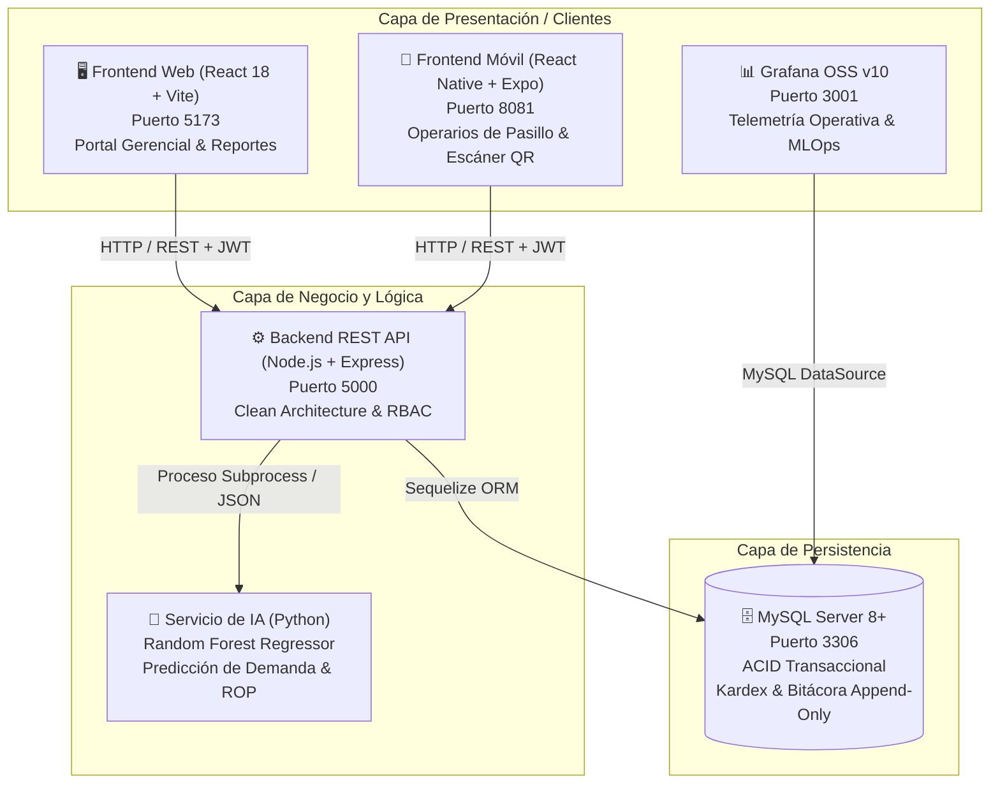

# 🏥 Ecosistema de Gestión, Trazabilidad e Inteligencia de Inventarios
### Almacén Central — Caja Petrolera de Salud (CPS), Cochabamba


Solución hospitalaria empresarial para el control integral, trazabilidad inmutable y pronóstico inteligente de inventarios de la **Caja Petrolera de Salud (Regional Cochabamba)**. Construida bajo **Clean Architecture**, **SOLID**, **lógica estricta por lotes**, **asientos contables inmutables en Kardex**, **bitácora forense de auditoría** y cumplimiento riguroso de las reglas **FEFO** (fármacos) y **FIFO** (material administrativo).

---

## 📌 Documentación Técnica Detallada

Para profundizar en la ingeniería del proyecto, consulta los manuales en el directorio [`docs/`](./docs/):

* 📐 [**Arquitectura de Software**](./docs/ARCHITECTURE.md): Capas de Clean Architecture, microservicios y diagramas de secuencia.
* 🔌 [**Especificación de la API RESTful**](./docs/API.md): Endpoints, payloads JSON, códigos HTTP y alertas FEFO (403).
* 🗄️ [**Diccionario de Base de Datos**](./docs/DATABASE.md): Esquema MySQL relacional, índices de alto rendimiento y ERD.
* 🧠 [**Modelos de Inteligencia Artificial**](./docs/AI_MODELS.md): Random Forest, ingeniería de características temporales y fórmulas estocásticas de ROP y SS.
* 🤖 [**Personalizaciones para Agentes de IA (.agents/)**](./.agents/README.md): Habilidades y reglas para Google Antigravity.
* 🤝 [**Guía de Contribución**](./CONTRIBUTING.md): Flujo de trabajo con ramas Git y estándares de código.

---

## 🏛️ Arquitectura del Ecosistema



---

## 🚀 Puesta en Marcha Rápida (Entorno Local)

### Opción A: Lanzador General en 1 Clic (Recomendado en Windows)
Haz doble clic en el archivo o ejecútalo desde la terminal en la raíz del proyecto:
```cmd
.\iniciar_todo.bat
```
*Este script verifica MySQL, arranca el Backend API (5000), el Frontend Web (5173), Expo Metro (8081) y Grafana (3001) en ventanas independientes.*

---

### Opción B: Inicio Manual Servicio por Servicio

#### 1. Base de Datos MySQL
En tu gestor MySQL (MySQL Workbench, XAMPP o Docker), ejecuta:
```sql
source database/schema.sql;
source database/seeds.sql;
```
O ejecuta el seeder automático en Node.js:
```bash
cd backend && npm run db:seed
```

#### 2. Backend (API RESTful)
```bash
cd backend
npm install
npm run dev
```
* Servidor activo en: `http://localhost:5000`
* Verificación de salud: `http://localhost:5000/api/v1/health`

#### 3. Frontend Web (Dashboard Gerencial)
```bash
cd frontend_web
npm install
npm run dev
```
* Portal Web disponible en: `http://localhost:5173`

#### 4. Frontend Móvil (Operarios en Pasillo)
```bash
cd frontend_mobile
npm install
npx expo start
```
* Escanea el código QR con **Expo Go** en Android/iOS o presiona `a` para emulador Android.

#### 5. Servicio de Grafana
```bash
cd grafana_service
.\run_grafana.bat
```
* Dashboards institucionales listos en: `http://localhost:3001` (Admin / Admin)

---

## 🔑 Credenciales Institucionales de Prueba (Bcrypt Costo 10)

| Rol Institucional | Correo Electrónico | Contraseña | Alcance y Permisos |
| :--- | :--- | :--- | :--- |
| **Administrador** | `admin@cps.gob.bo` | `Admin123*` | Control total, configuración de usuarios, auditoría forense y catálogo base |
| **Gerente** | `gerencia@cps.gob.bo` | `Admin123*` | Dashboard gerencial, valorización monetaria, rotación y semáforos de vencimiento |
| **Encargado** | `encargado@cps.gob.bo` | `Admin123*` | Recepción de mercancía por lotes, emisión de códigos QR e insumos |
| **Operario** | `operario@cps.gob.bo` | `Admin123*` | App móvil: Escaneo QR en pasillos, confirmación de egresos y validación FEFO |
| **Solicitante** | `solicitante@cps.gob.bo` | `Admin123*` | Solicitudes de insumos para salas médicas, pisos hospitalarios y quirófanos |

---

## 🛡️ Reglas Críticas del Sistema

### 1. Rotación Sanitaria Obligatoria: FEFO
* Si un operario intenta egresar un lote sanitario teniendo otro lote con fecha de caducidad anterior y stock disponible, la API bloquea el despacho:
  * **Código HTTP:** `403 Forbidden`
  * **Payload:** Detalla el lote rechazado y el lote obligatorio que debe retirarse con su pasillo y estante.
  * **App Móvil:** Muestra el modal rojo de emergencia médica impidiendo el error humano.

### 2. Rotación Administrativa: FIFO
* Insumos de oficina y mantenimiento se despachan según el orden cronológico de ingreso a almacén.

### 3. Inmutabilidad en Kardex y Bitácora (Append-Only)
* Los modelos `MovimientoKardex` y `BitacoraAuditoria` rechazan a nivel de base de datos y ORM cualquier sentencia `UPDATE` o `DELETE`. Toda corrección requiere un asiento contable compensatorio.

### 4. Inteligencia Artificial (Random Forest)
* El motor predictivo analiza la demanda histórica y calcula estocásticamente el **Punto de Reorden ($ROP$)** y el **Stock de Seguridad ($SS$)** con un Nivel de Servicio Hospitalario del 95%:
  $$ROP = (\bar{d} \times L) + (1.645 \times \sigma_d \times \sqrt{L})$$

---

## 📂 Estructura del Repositorio

```text
Almacen_CPS/
├── .agents/                     # Antigravity Skills, Reglas y Subagentes
│   ├── skills/                  # Runbooks de FEFO, IA, Kardex y Desarrollo
│   ├── rules/                   # Reglas de cumplimiento sanitario y código
│   └── agents/                  # Definición de subagentes especializados
├── database/                    # Esquema DDL relacional y semillas MySQL
│   ├── schema.sql
│   └── seeds.sql
├── backend/                     # API RESTful en Node.js + Express (Clean Arch)
│   ├── src/
│   │   ├── config/              # Sequelize y JWT
│   │   ├── middlewares/         # RBAC, Auditoría y Manejador de Errores
│   │   ├── models/              # Modelos inmutables y relacionales
│   │   └── modules/             # Auth, Users, Items, Reception, Dispatch, AI, Dashboard
│   └── package.json
├── frontend_web/                # Dashboard Administrativo en React + Vite + Tailwind
│   ├── src/components/          # Semáforos, Métricas, Gráficos y Modales
│   └── package.json
├── frontend_mobile/             # App Móvil para Operarios en Pasillo (Expo)
│   ├── src/screens/             # Escáner QR, Detalle de Lote y Alerta FEFO
│   └── package.json
├── ai_service/                  # Microservicio de IA en Python (Random Forest)
│   ├── predict_demand.py
│   └── dataset_pedidos_materiales_cps_cochabamba_1_anio.csv
├── grafana_service/             # Dashboards OSS provisionados
│   ├── conf/
│   └── provisioning/
├── docs/                        # Documentación técnica de arquitectura, API y DB
├── AGENTS.md                    # Directrices maestras para agentes de IA
├── CONTRIBUTING.md               # Guía de contribución y ramas Git
└── iniciar_todo.bat             # Lanzador integral del ecosistema en Windows
```

---

## ⚖️ Licencia
Desarrollado para la **Caja Petrolera de Salud (CPS), Regional Cochabamba**, Bolivia. Todos los derechos reservados.
