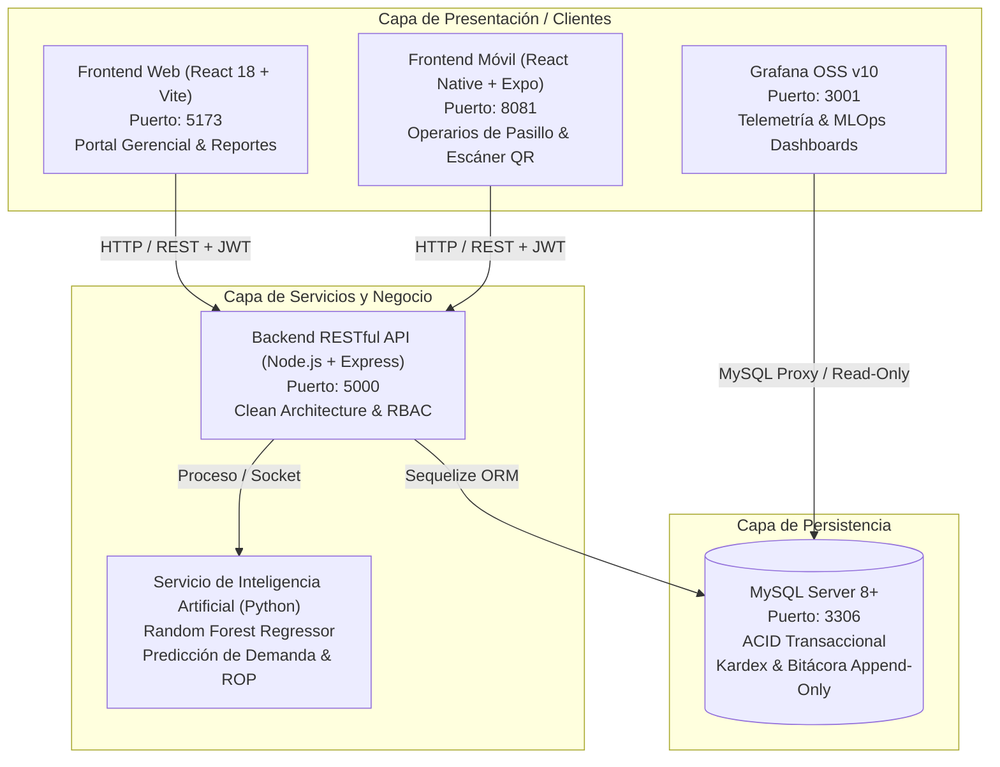
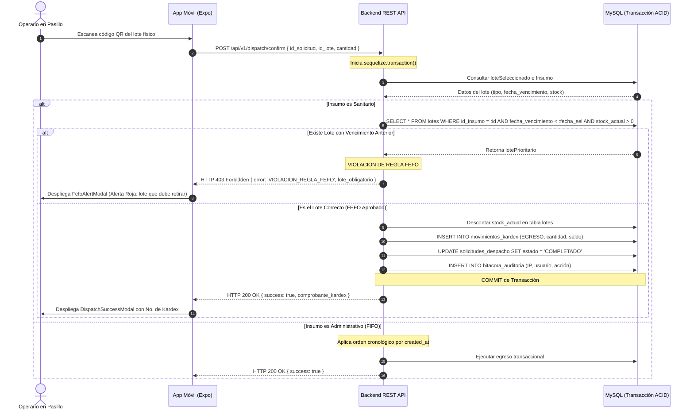

# Arquitectura del Sistema — Almacén Central CPS Cochabamba

Este documento describe la arquitectura técnica, los patrones de diseño, el flujo de datos y las garantías de seguridad del **Ecosistema de Gestión, Trazabilidad e Inteligencia de Inventarios** de la Caja Petrolera de Salud (CPS).

---

## 1. Visión General de la Arquitectura

El sistema está diseñado bajo una arquitectura modular desacoplada basada en microservicios y Clean Architecture:

---

## 2. Diagrama de Secuencia: Despacho Hospitalario con Validación FEFO

La regla **FEFO** (First Expired, First Out) es obligatoria para insumos clasificados como sanitarios. A continuación se ilustra el flujo cuando un operario escanea un código QR:

---

## 3. Capas de la Clean Architecture en el Backend

1. **Entities / Models (`src/models/`):**
   * Definición declarativa en Sequelize de tablas relacionales con validación de tipos, restricciones `NOT NULL`, llaves foráneas e índices.
   * Hooks defensivos para prevenir `UPDATE` o `DELETE` sobre `MovimientoKardex` y `BitacoraAuditoria`.
2. **Services (`src/modules/*/service.js`):**
   * Contienen toda la lógica de negocio pura: cálculo de saldos ponderados, verificación FEFO/FIFO, transacciones multi-tabla y llamadas al motor predictivo.
3. **Controllers (`src/modules/*/controller.js`):**
   * Recepción y validación de peticiones HTTP, extracción de parámetros (`req.body`, `req.params`) y serialización de respuestas mediante `responseHandler.js`.
4. **Middlewares (`src/middlewares/`):**
   * `authMiddleware.js`: Verificación de tokens JWT y extracción de usuario activo.
   * `roleMiddleware.js`: Control de acceso basado en roles (RBAC).
   * `auditMiddleware.js`: Interceptor automático para bitácora forense con IP y User-Agent.
   * `errorHandler.js`: Manejo global de excepciones para evitar filtración de trazas internas.

---

## 4. Inmutabilidad y Auditoría Forense

Cualquier cambio de estado en la base de datos deja un rastro inmutable:

* **Kardex Contable:** Los movimientos (`INGRESO`, `EGRESO`, `AJUSTE_POSITIVO`, `AJUSTE_NEGATIVO`) recalculan el saldo acumulado en cada fila. No existe actualización de saldos antiguos.
* **Bitácora de Auditoría:** Almacena el ID del usuario, la acción realizada, la dirección IP de origen, la fecha/hora en zona horaria boliviana (`-04:00`), y los objetos JSON con los valores anteriores y los valores nuevos.
