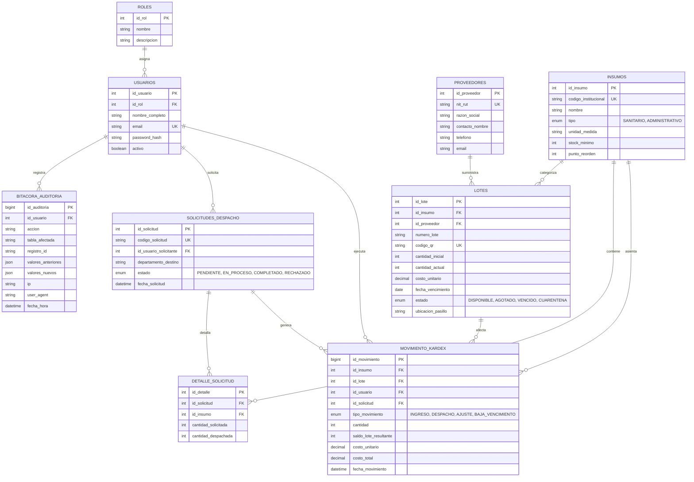

# Diccionario y Arquitectura de Base de Datos — Almacén CPS

* **Motor:** MySQL 8.0+
* **Motor de Almacenamiento:** InnoDB (Soporte transaccional ACID)
* **Juego de Caracteres:** `utf8mb4` / Collation: `utf8mb4_unicode_ci`
* **Base de Datos:** `almacen_cps`

---

## 1. Diagrama Entidad-Relación (ERD)

---

## 2. Estrategia de Indexación de Alto Rendimiento

Para asegurar que las consultas de validación en pasillo y entrenamiento de modelos respondan en milisegundos:

1. **Escaneo QR en Pasillo (`idx_lotes_qr`):**
   * Índice único en `lotes.codigo_qr`. Búsqueda $O(1)$ cuando la cámara del dispositivo móvil captura la etiqueta térmica.
2. **Consulta FEFO en Tiempo Real (`idx_lotes_fefo`):**
   * Índice compuesto: `(id_insumo, estado, fecha_vencimiento, cantidad_actual)`.
   * Permite evaluar instantáneamente si existe un lote más antiguo sin hacer full-table scan.
3. **Consulta FIFO en Tiempo Real (`idx_lotes_fifo`):**
   * Índice compuesto: `(id_insumo, estado, fecha_ingreso, cantidad_actual)`.
4. **Alimentación del Modelo de Machine Learning (`idx_kardex_ml`):**
   * Índice compuesto: `(id_insumo, fecha_movimiento, tipo_movimiento)`.
   * Agrupa los consumos históricos por serie temporal eficientemente.

---

## 3. Garantías de Integridad y Restricciones de Check

* `chk_lote_cantidad_positiva`: Asegura que `cantidad_actual >= 0` a nivel de base de datos, impidiendo inventarios negativos.
* `chk_lote_costo_positivo`: Garantiza costos unitarios no negativos.
* `chk_detalle_cantidades`: Valida que `cantidad_solicitada > 0` y `cantidad_despachada >= 0`.
* Llaves foráneas con `ON DELETE RESTRICT` en catálogos base (insumos, proveedores, roles y usuarios) para prevenir eliminaciones en cascada accidentales.
